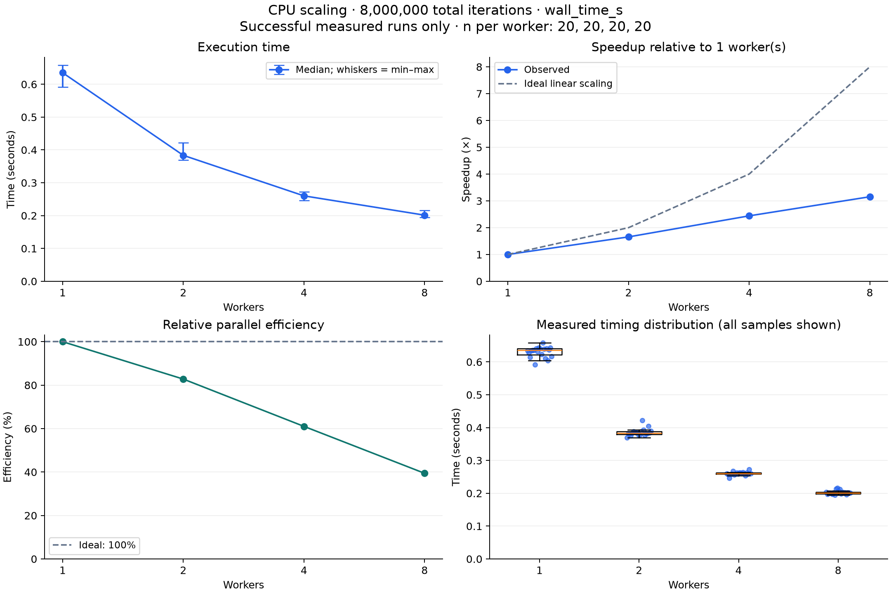

Source: /Users/aiyuwu/development/powerperf-lab/results/cpu-scaling/runs.csv

# CPU scaling analysis

Timing metric: `wall_time_s`. Total iterations per run: 8,000,000.
Included 80 measured runs; excluded 4 warmups, 0 unsuccessful measured runs, and 0 successful measured runs without the selected timing.
Checksum consistent across successful measured runs: `3999171993312`.

| Workers | Runs | Median (s) | Min (s) | Max (s) | CV (%) | Speedup | Relative efficiency (%) |
| --- | --- | --- | --- | --- | --- | --- | --- |
| 1 | 20 | 0.635074 | 0.591428 | 0.658404 | 2.50 | 1.00x | 100.00 |
| 2 | 20 | 0.383537 | 0.369037 | 0.421527 | 2.91 | 1.66x | 82.79 |
| 4 | 20 | 0.260167 | 0.246601 | 0.272330 | 1.97 | 2.44x | 61.03 |
| 8 | 20 | 0.201371 | 0.194593 | 0.216574 | 2.88 | 3.15x | 39.42 |

Speedup baseline: 1 worker(s). Relative efficiency is speedup divided by the worker-count increase from that baseline.
Lowest observed median: 8 worker(s), 0.201371 s.

CV is sample standard deviation divided by mean timing. A single run cannot estimate variability. These descriptive results do not establish statistical significance.
Analyze each experiment separately: workload size, machine, and measurement conditions must be comparable.
CPU and memory telemetry are not power or energy measurements.

Measured run statuses: ok=80.

## Charts

[Download PDF](scaling.pdf)
